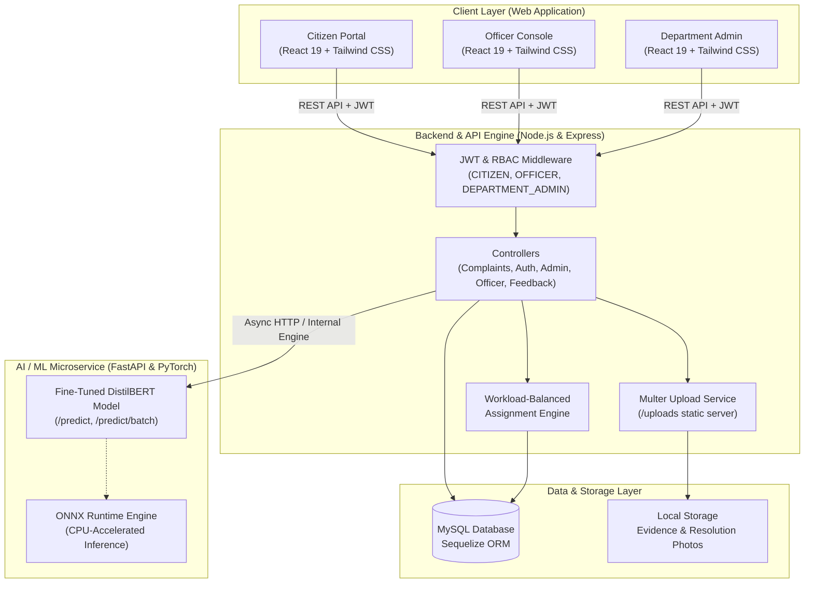
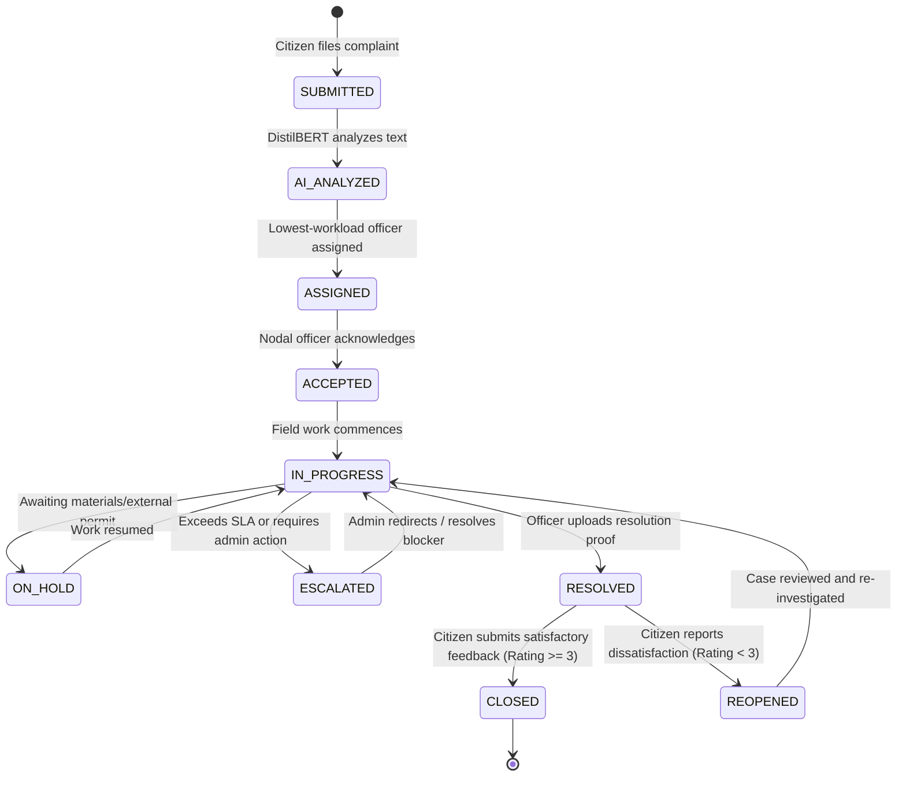

# 🏛️ AI-Powered Smart Public Grievance Redressal & Automated Routing Portal

[](https://react.dev/)
[](https://nodejs.org/)
[](https://www.mysql.com/)
[](https://pytorch.org/)
[](https://fastapi.tiangolo.com/)
[](https://tailwindcss.com/)
[](#project-credits--metadata)

An intelligent, full-stack civic governance portal that streamlines public grievance redressal for smart cities and state administrations. It integrates **NLP-driven grievance categorization (DistilBERT / BERT)**, **workload-balanced nodal officer dispatch**, **multi-role role-based access control (RBAC)**, **photographic resolution auditing**, and **citizen satisfaction feedback loops**.

---

## 📑 Table of Contents

- [Overview & Problem Statement](#-overview--problem-statement)
- [Key Features by Role](#-key-features-by-role)
  - [1. Citizen Portal](#1-citizen-portal)
  - [2. AI Classification Microservice](#2-ai-classification-microservice)
  - [3. Automated Nodal Officer Routing](#3-automated-nodal-officer-routing)
  - [4. Nodal Officer Console](#4-nodal-officer-console)
  - [5. Departmental Admin Command Center](#5-departmental-admin-command-center)
- [System Architecture & Lifecycle](#-system-architecture--lifecycle)
  - [High-Level Architecture](#high-level-architecture)
  - [Grievance Ticket Lifecycle](#grievance-ticket-lifecycle)
- [Project Directory Layout](#-project-directory-layout)
- [Database Schema & Data Model](#-database-schema--data-model)
- [Prerequisites](#-prerequisites)
- [Step-by-Step Installation & Setup](#-step-by-step-installation--setup)
  - [1. Database Configuration](#step-1-database-configuration)
  - [2. Backend Setup](#step-2-backend-setup)
  - [3. AI Classifier Microservice Setup](#step-3-ai-classifier-microservice-setup)
  - [4. Frontend Setup](#step-4-frontend-setup)
- [Pre-Seeded Test Credentials](#-pre-seeded-test-credentials)
- [REST API Reference Summary](#-rest-api-reference-summary)
- [Testing & Quality Assurance](#-testing--quality-assurance)
- [Security & Data Isolation](#-security--data-isolation)
- [Project Credits & Metadata](#-project-credits--metadata)

---

## 💡 Overview & Problem Statement

### The Problem
Traditional public grievance portals suffer from severe operational friction:
- **Manual Triage Delays:** Administrative staff spend days reading, manually sorting, and forwarding complaints to various departments.
- **Misclassification & Department Ping-Pong:** Complaints regarding road-side open drains or fallen electric cables are frequently tossed between municipal corporations, electricity boards, and highway divisions.
- **Workload Imbalances:** Certain field officers receive an overwhelming volume of grievances while others in adjacent circles remain underutilized.
- **Lack of Transparency & Accountability:** Citizens have minimal visibility into who is handling their issue, SLAs are unenforced, and complaints are often closed without verifiable proof.

### The Solution
The **Smart Grievance Portal** automates the entire civic issue lifecycle:
1. **Intelligent Ingestion:** Citizens submit complaints with descriptions, geo-coordinates, and photo evidence.
2. **Instant NLP Classification:** Fine-tuned Transformer models (DistilBERT) analyze the complaint text and classify it into one of **12 municipal departments** with a confidence score and top-3 department ranking.
3. **Automated Balanced Allocation:** The backend algorithm identifies all active nodal officers in the complainant's district and department, automatically assigning the ticket to the officer with the **lowest active workload**.
4. **Verifiable Resolution & Citizen Loop:** Officers must submit photographic proof before marking a ticket resolved. Citizens can review the fix, assign a 1-5 star rating, or automatically trigger a reopening if unsatisfied.

---

## ✨ Key Features by Role

### 1. Citizen Portal
- **Modern Responsive Interface:** Built with React 19, Tailwind CSS, and Lucide icons.
- **Grievance Lodging:** Clean multi-field form supporting title, detailed description, street address, geolocation coordinates (latitude/longitude), district selection (all 38 Tamil Nadu districts supported), and multimedia evidence upload.
- **Real-Time Ticket Tracking:** Unique tracking identifiers (e.g., `GRV-2026-001245`) with a timeline view reflecting every state transition.
- **Citizen Feedback & Reopening:** Post-resolution feedback rating (1 to 5 stars) with comments. Low-satisfaction ratings can trigger ticket reopening for administrative review.
- **Account & Profile Management:** View past grievances, manage contact information, and change passwords.

### 2. AI Classification Microservice
- **Model Architecture:** Fine-tuned `distilbert-base-uncased` sequence classifier trained on civic grievance datasets.
- **12 Department Categories:**
  1. *Roads and Highways*
  2. *Water Supply*
  3. *Electricity*
  4. *Sanitation*
  5. *Drainage and Sewerage*
  6. *Public Health*
  7. *Municipal Administration*
  8. *Transport*
  9. *Parks and Recreation*
  10. *Environment*
  11. *Street Lighting*
  12. *Animal Control*
- **Inference Acceleration:** Supports standard PyTorch execution and **ONNX Runtime** export for up to 5x faster CPU inference.
- **Developer Tools:** Interactive CLI testing mode (`python predict_bert.py --interactive`) and FastAPI REST service with automated Swagger documentation.

### 3. Automated Nodal Officer Routing
- **District & Department Match:** Matches the grievance's location with the responsible administrative department.
- **Dynamic Workload Balancing:** Queries all active officers (`status: 'ACTIVE'`) within the matching department and district, calculates their open ticket count (`status NOT IN ('RESOLVED', 'CLOSED', 'REJECTED')`), and assigns the ticket to the least-burdened officer.
- **Admin Fallback:** If no field officer is available for that district/department combination, the ticket flags for manual admin intervention.

### 4. Nodal Officer Console
- **Regional Dashboard:** Scoped strictly to the officer's assigned department and district.
- **Workload & SLA Monitoring:** Summary counts of assigned, pending, in-progress, and resolved complaints.
- **Full Workflow Execution:** Actions to `Accept`, `Start Progress`, `Put On Hold`, `Escalate to Admin`, or `Resolve`.
- **Resolution Proof Upload:** Required upload of after-repair photographic proof upon resolving the grievance.

### 5. Departmental Admin Command Center
- **Executive Bento Analytics:** Live metrics including total departmental complaints, pending backlogs, resolution rate, and average turnaround time.
- **Regional Officer Management:** Onboard new nodal officers, update designation/contact info, and activate or deactivate officers.
- **Deep Analytics & Reports:** District-wise grievance heatmaps, individual officer performance logs, and monthly complaint trend charts.
- **SLA Escalation Intervention:** Direct oversight on escalated or overdue grievances.

---

## 🏗️ System Architecture & Lifecycle

### High-Level Architecture



---

### Grievance Ticket Lifecycle



---

## 📁 Project Directory Layout

```
grievance_portal/
│
├── README.md                          # Master Project Documentation
│
├── backend/                           # Node.js & Express REST API Server
│   ├── .env.example                   # Environment configuration template
│   ├── app.js                         # Express application setup & middleware mounting
│   ├── server.js                      # Server bootstrapper & database connection
│   ├── package.json                   # Backend dependencies & npm scripts
│   ├── queries.sql                    # Initial SQL reference schema
│   ├── uploads/                       # Grievance images and resolution photo uploads
│   ├── tests/
│   │   └── runTests.js                # Multi-tenant RBAC boundary security tests
│   └── src/
│       ├── config/                    # Database (Sequelize) & Environment configs
│       ├── controllers/               # Route controllers (Auth, Complaint, Admin, Officer, etc.)
│       ├── database/
│       │   ├── sync.js                # Schema migration / synchronization script
│       │   └── seed.js                # Seed script (38 districts, 12 departments, test users)
│       ├── middleware/                # Auth, RBAC, File upload, and Error handlers
│       ├── models/                    # Sequelize ORM models (11 relational models)
│       ├── routes/                    # Express route declarations
│       ├── services/                  # Business logic (AI service, Assignment, Notifications)
│       ├── utils/                     # Winston logger, constants, helpers
│       └── validators/                # express-validator request sanitizers
│
├── ai-service/                        # AI Computer Vision (YOLO) Issue Detection Service
│   ├── requirements.txt               # Vision dependencies (ultralytics, opencv, torch)
│   ├── run_service.py                 # FastAPI runner (Port 8001)
│   ├── start_service.bat              # 1-click Windows runner
│   ├── start_background_service.ps1   # PowerShell background service daemon
│   ├── test_client.py                 # End-to-end integration test client
│   ├── app/                           # FastAPI app, detector, and preprocessing logic
│   ├── models/                        # Pretrained road damage and garbage YOLO weights
│   ├── training/                      # Reproducible YOLO train and evaluate scripts
│   └── tests/                         # Pytest test suite (health, predictions, validation)
│
├── department-classifier/             # NLP Department Classifier Microservice (Port 8000)
│   ├── requirements.txt               # Python package dependencies
│   ├── Dockerfile                     # Multi-stage production container build
│   ├── docker-compose.yml             # Local container runner
│   ├── train_bert.py                  # PyTorch / Hugging Face model training pipeline
│   ├── eval_test_set.py               # Test split evaluation & metrics reporter
│   ├── predict_bert.py                # Standalone & interactive CLI prediction tool
│   ├── dataset/
│   │   └── complaints_dataset.csv     # Labeled grievance complaints dataset
│   └── grievance-bert-model/          # Serialized model checkpoint directory
│       ├── config.json                # Transformer configuration
│       ├── model.safetensors          # Fine-tuned model weights
│       ├── label_mapping.json         # Bidirectional department label mappings
│       ├── tokenizer.json             # WordPiece tokenizer vocabulary
│       └── tokenizer_config.json      # Tokenizer configurations
│
└── frontend/                          # React 19 Single Page Application
    ├── package.json                   # Frontend dependencies & npm scripts
    ├── tailwind.config.js             # Tailwind CSS configuration
    ├── public/                        # Static HTML assets and favicon
    └── src/
        ├── App.js                     # Root component & role-based view routing
        ├── index.css                  # Global styles & Tailwind imports
        ├── components/
        │   ├── Auth/                  # Login and Registration components (Multi-role)
        │   ├── common/                # Reusable UI icons, badges, and modals
        │   ├── Landing/               # Hero, stats, features, how-it-works sections
        │   └── Dashboard/             # Role-specific consoles
        │       ├── CitizenDashboard.jsx
        │       ├── OfficerDashboard.jsx
        │       ├── AdminDashboard.jsx
        │       ├── NewComplaintForm.jsx
        │       ├── GrievanceTracking.jsx
        │       ├── NotificationCenter.jsx
        │       └── AccountSettings.jsx
        └── utils/
            └── api.js                 # Centralized API service wrapper with Bearer token handling
```

---

## 🗄️ Database Schema & Data Model

The application utilizes MySQL with Sequelize ORM. The relational model comprises 11 coordinated entities:

| Model | Table Name | Purpose | Key Relations |
| :--- | :--- | :--- | :--- |
| **District** | `districts` | Stores the 38 administrative districts of Tamil Nadu | Referenced by `citizens`, `officers`, `complaints` |
| **Department** | `departments` | 12 civic departments (Highways, Water, Electricity, etc.) | Referenced by `department_admins`, `officers`, `complaints` |
| **Citizen** | `citizens` | Registered public users lodging grievances | Has many `complaints`, `feedback` |
| **Officer** | `officers` | Field nodal officers designated per district/department | Belongs to `district` & `department`, has many `complaints` |
| **DepartmentAdmin** | `department_admins` | Department-level administrative monitors | Belongs to `department` |
| **Complaint** | `complaints` | Core grievance entity with unique ticket numbers | Belongs to `citizen`, `department`, `district`, `officer` |
| **ComplaintAIAnalysis** | `complaint_ai_analysis` | Stores predicted department, confidence, summary, OCR | Belongs to `complaint` (1:1) |
| **ComplaintImage** | `complaint_images` | Photographic evidence uploaded by citizens/officers | Belongs to `complaint` |
| **ComplaintStatusHistory**| `complaint_status_history`| Audit trail of status transitions with timestamps | Belongs to `complaint` |
| **Feedback** | `feedbacks` | Citizen satisfaction score (1-5) and review | Belongs to `complaint` & `citizen` |
| **Notification** | `notifications` | In-app alerts for updates, assignments, and escalations | Belongs to `citizen` or `officer` |

---

## ⚙️ Prerequisites

Before getting started, make sure the following software is installed on your machine:

- **Node.js**: v18.0.0 or higher ([Download Node.js](https://nodejs.org/))
- **npm**: v9.0.0 or higher (comes bundled with Node.js)
- **Python**: v3.10 to v3.12 ([Download Python](https://www.python.org/))
- **MySQL Server**: v8.0 or higher ([Download MySQL](https://dev.mysql.com/downloads/mysql/))
- **Git** (optional, for version control)
- **Docker & Docker Compose** (optional, for containerized AI deployment)

---

## 🚀 Step-by-Step Installation & Setup

### Step 1: Database Configuration

1. Launch your MySQL command line client or MySQL Workbench.
2. Create the project database:
   ```sql
   CREATE DATABASE grievance_portal;
   ```
   *(Alternatively, `CREATE DATABASE SmartGrievance;` if you prefer following `queries.sql`)*

---

### Step 2: Backend Setup

1. Open a terminal and navigate to the `backend/` directory:
   ```bash
   cd backend
   ```

2. Install backend dependencies:
   ```bash
   npm install
   ```

3. Create your `.env` configuration file:
   ```bash
   # On Windows PowerShell:
   Copy-Item .env.example .env

   # On Linux/macOS:
   cp .env.example .env
   ```

4. Edit the newly created `.env` file with your MySQL server credentials:
   ```env
   PORT=5000
   NODE_ENV=development

   DB_HOST=localhost
   DB_PORT=3306
   DB_NAME=grievance_portal
   DB_USER=root
   DB_PASSWORD=your_mysql_password

   JWT_SECRET=supersecretjwttokendesignkey123!
   JWT_EXPIRES_IN=1d

   UPLOAD_DIR=uploads
   AI_SERVICE_URL=http://localhost:8000
   ```

5. **Initialize Database Schema (Migrations):**
   This synchronizes all Sequelize models, creates clean tables, and indexes:
   ```bash
   npm run migrate
   ```

6. **Seed Initial Data:**
   Seeds all 38 districts of Tamil Nadu, 12 departments, administrative accounts, regional nodal officers, sample citizens, and initial test complaints:
   ```bash
   npm run seed
   ```

7. **Start the Backend API Server:**
   ```bash
   npm run dev
   ```
   The backend will start at **`http://localhost:5000`**. You can verify it by opening `http://localhost:5000` in your browser.

---

### Step 3: AI Classifier Microservice Setup

The NLP classifier can be run in two ways: as a standalone Python test suite / interactive CLI, or as a FastAPI microservice.

#### Option A: Local Python Virtual Environment

1. Open a new terminal and navigate to `department-classifier/`:
   ```bash
   cd department-classifier
   ```

2. Create and activate a Python virtual environment:
   ```bash
   # On Windows:
   python -m venv .venv
   .venv\Scripts\activate

   # On Linux / macOS:
   python3 -m venv .venv
   source .venv/bin/activate
   ```

3. Install requirements:
   ```bash
   pip install -r requirements.txt
   ```

4. **Run the Pre-Trained Classifier Verification:**
   Test the fine-tuned BERT model on civic complaints:
   ```bash
   python predict_bert.py
   ```

5. **Run the Interactive Grievance Classifier CLI:**
   You can enter any complaint sentence to see real-time department routing and confidence percentages:
   ```bash
   python predict_bert.py --interactive
   ```

6. *(Optional)* **Run Test Set Evaluation:**
   To verify accuracy, weighted F1, precision, and recall on the stratified test split:
   ```bash
   python eval_test_set.py
   ```

#### Option B: Run via Docker (Optional)

```bash
cd department-classifier
docker-compose up --build
```
This runs the containerized inference engine on port **`8000`**.

---

### Step 4: Frontend Setup

1. Open another terminal and navigate to `frontend/`:
   ```bash
   cd frontend
   ```

2. Install React dependencies:
   ```bash
   npm install
   ```

3. Configure your frontend `.env` (optional; defaults to `http://localhost:5000/api` if unspecified):
   ```env
   REACT_APP_API_URL=http://localhost:5000/api
   ```

4. Start the React development server:
   ```bash
   npm start
   ```
   The browser should automatically open **`http://localhost:3000`**.

---

## 🔑 Pre-Seeded Test Credentials

Use these credentials (generated by `npm run seed`) to test the system across all user roles:

### 1. Citizen Accounts
| Role | Email | Password | Details |
| :--- | :--- | :--- | :--- |
| **Citizen (Salem)** | `anbu@gmail.com` | `citizenpassword123` | Has active pre-seeded complaints in Salem |
| **Citizen (Erode)** | `bharath@gmail.com` | `citizenpassword123` | Registered in Erode district |

---

### 2. Nodal Officer Accounts
| Role / Designation | Email (Username) | Password | Jurisdiction |
| :--- | :--- | :--- | :--- |
| **Divisional Engineer (DE)** | `ramesh.srinivasan@gov.in` | `officerpassword123` | Roads and Highways (Salem) |
| **Assistant Engineer (AE)** | `kavitha.natarajan@gov.in` | `officerpassword123` | Roads and Highways (Erode) |
| **Asst. Divisional Engineer** | `vijay.joseph@gov.in` | `officerpassword123` | Roads and Highways (Coimbatore) |
| **AE - Water Distribution** | `anita.desai@gov.in` | `officerpassword123` | Water Supply (Salem) |

---

### 3. Department Admin Accounts
Department admins manage all regional officers and complaints for their respective department across all 38 districts:

| Department | Admin Email | Password |
| :--- | :--- | :--- |
| **Roads and Highways** | `admin.roads.and.highways@gov.in` | `adminpassword123` |
| **Water Supply** | `admin.water.supply@gov.in` | `adminpassword123` |
| **Electricity** | `admin.electricity@gov.in` | `adminpassword123` |
| **Sanitation** | `admin.sanitation@gov.in` | `adminpassword123` |
| **Drainage and Sewerage**| `admin.drainage.and.sewerage@gov.in`| `adminpassword123` |
| *(Any other department)* | `admin.<department.name>@gov.in` | `adminpassword123` |

---

## 🔌 REST API Reference Summary

### Authentication (`/api/auth`)
| Method | Endpoint | Access | Description |
| :--- | :--- | :--- | :--- |
| `POST` | `/api/auth/citizen/register` | Public | Register a new citizen account |
| `POST` | `/api/auth/citizen/login` | Public | Authenticate citizen; returns JWT |
| `POST` | `/api/auth/officer/login` | Public | Authenticate nodal officer; returns JWT |
| `POST` | `/api/auth/admin/login` | Public | Authenticate department admin; returns JWT |

### Citizen Operations (`/api/citizens` & `/api/complaints`)
| Method | Endpoint | Access | Description |
| :--- | :--- | :--- | :--- |
| `GET` | `/api/citizens/me` | Citizen | Retrieve logged-in citizen profile |
| `PUT` | `/api/citizens/me` | Citizen | Update contact info and address |
| `PUT` | `/api/citizens/change-password` | Citizen | Change citizen account password |
| `POST` | `/api/complaints` | Citizen | File a new grievance (multipart with photo attachments) |
| `GET` | `/api/complaints/my` | Citizen | Retrieve citizen's grievance list (with pagination) |
| `GET` | `/api/complaints/:id` | Authenticated | View complaint details, timeline, and AI analysis |
| `POST` | `/api/complaints/:id/feedback` | Citizen | Submit 1-5 star rating and review (auto-reopens if unsatisfied) |

### Nodal Officer Operations (`/api/officer`)
| Method | Endpoint | Access | Description |
| :--- | :--- | :--- | :--- |
| `GET` | `/api/officer/dashboard` | Officer | Summary stats (assigned, pending, resolved counts) |
| `GET` | `/api/officer/complaints` | Officer | Query complaints assigned to officer's jurisdiction |
| `PATCH` | `/api/officer/complaints/:id/accept` | Officer | Acknowledge ticket (`ACCEPTED`) |
| `PATCH` | `/api/officer/complaints/:id/start` | Officer | Mark ticket as underway (`IN_PROGRESS`) |
| `PATCH` | `/api/officer/complaints/:id/hold` | Officer | Place on hold with remarks (`ON_HOLD`) |
| `PATCH` | `/api/officer/complaints/:id/escalate` | Officer | Escalate ticket to Department Admin (`ESCALATED`) |
| `PATCH` | `/api/officer/complaints/:id/resolve` | Officer | Mark grievance as resolved (`RESOLVED`) |
| `POST` | `/api/officer/complaints/:id/resolution-image`| Officer | Upload photographic proof of resolution |

### Department Admin Operations (`/api/admin`)
| Method | Endpoint | Access | Description |
| :--- | :--- | :--- | :--- |
| `GET` | `/api/admin/dashboard` | Admin | Departmental overview KPIs and bento stats |
| `GET` | `/api/admin/complaints` | Admin | Filter all department grievances across all districts |
| `POST` | `/api/admin/officers` | Admin | Create a new regional nodal officer |
| `GET` | `/api/admin/officers` | Admin | List departmental officers and active workloads |
| `PUT` | `/api/admin/officers/:id` | Admin | Update officer designation and assignment |
| `PATCH` | `/api/admin/officers/:id/status` | Admin | Toggle officer active/inactive status |
| `GET` | `/api/admin/reports/districts` | Admin | District-wise complaint breakdown for charts |
| `GET` | `/api/admin/reports/officers` | Admin | Officer resolution SLA metrics |
| `GET` | `/api/admin/reports/trends` | Admin | Monthly intake vs. resolution trends |

---

## 🧪 Testing & Quality Assurance

### 1. Multi-Tenant Backend Boundary Tests
Validate role-based security locks and verify that cross-district and cross-department unauthorized data access attempts are strictly blocked:
```bash
cd backend
npm test
```
**Assertion Results:**
- `✓ Citizen A accesses Citizen A's complaint`
- `✓ Citizen B accesses Citizen A's complaint (Blocked with 403 Forbidden)`
- `✓ Highways Salem Officer accesses Salem Highways complaint`
- `✓ Highways Erode Officer accesses Salem Highways complaint (Blocked with 403 Forbidden)`
- `✓ Water Supply Salem Officer accesses Highways complaint (Blocked with 403 Forbidden)`
- `✓ Highways Admin accesses Highways complaint`
- `✓ Water Supply Admin accesses Highways complaint (Blocked with 403 Forbidden)`

### 2. AI Classifier Evaluation
Run validation metrics on the model's test split:
```bash
cd department-classifier
python eval_test_set.py
```
Outputs Accuracy, Weighted F1-score, Precision, Recall, and per-class classification tables.

---

## 🔒 Security & Data Isolation

- **Role-Based Access Control (RBAC):** Three distinct roles (`CITIZEN`, `OFFICER`, `DEPARTMENT_ADMIN`) enforced via JWT middleware.
- **District & Department Data Boundary:** Nodal officers are mathematically restricted to complaints where `officer.district_id == complaint.district_id` AND `officer.department_id == complaint.department_id`.
- **Parameter Validation & Sanitization:** All incoming requests are filtered using `express-validator` to eliminate SQL injection and XSS vectors.
- **Secure Password Storage:** Sensitive credentials hashed using `bcrypt` with work factor salts.
- **HTTP Security Headers:** Protected by `helmet` with custom CORS policies and content security rules.
- **Rate Limiting:** Prevents brute-force credential attacks on authentication endpoints.

---

## 👥 Project Credits & Metadata

- **Project Title:** AI-Based Public Grievance Redressal Portal
- **Academic Semester:** Semester 7 (S7) Capstone Engineering Project
- **Domain:** Artificial Intelligence, Full-Stack Web Development, E-Governance
- **Technologies:** React 19, Node.js, Express, MySQL, Sequelize, PyTorch, Hugging Face Transformers, DistilBERT, Tailwind CSS, FastAPI, Docker
